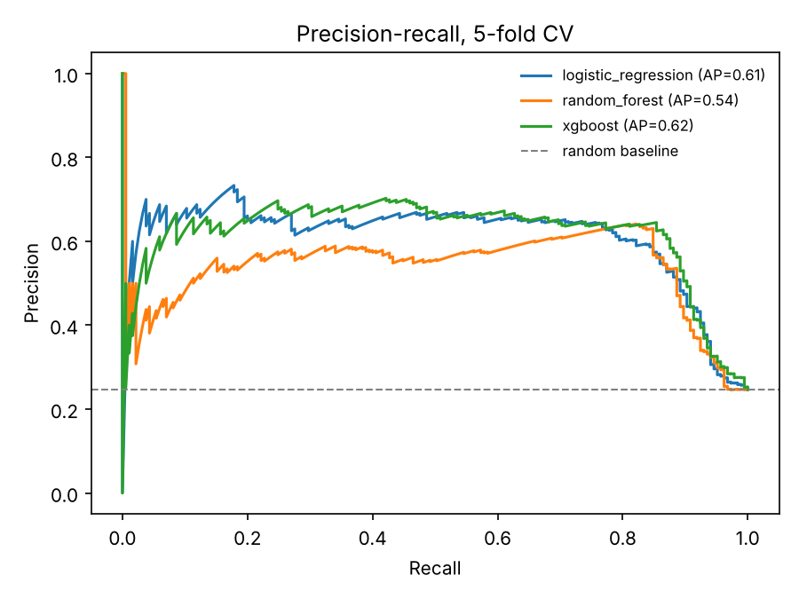
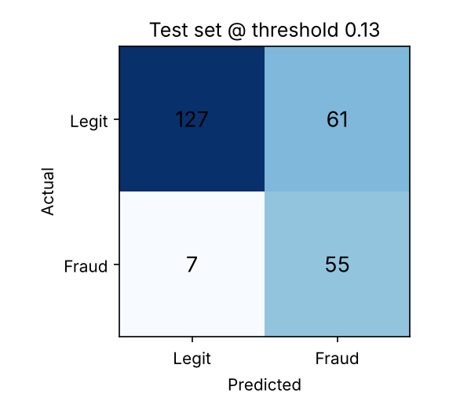
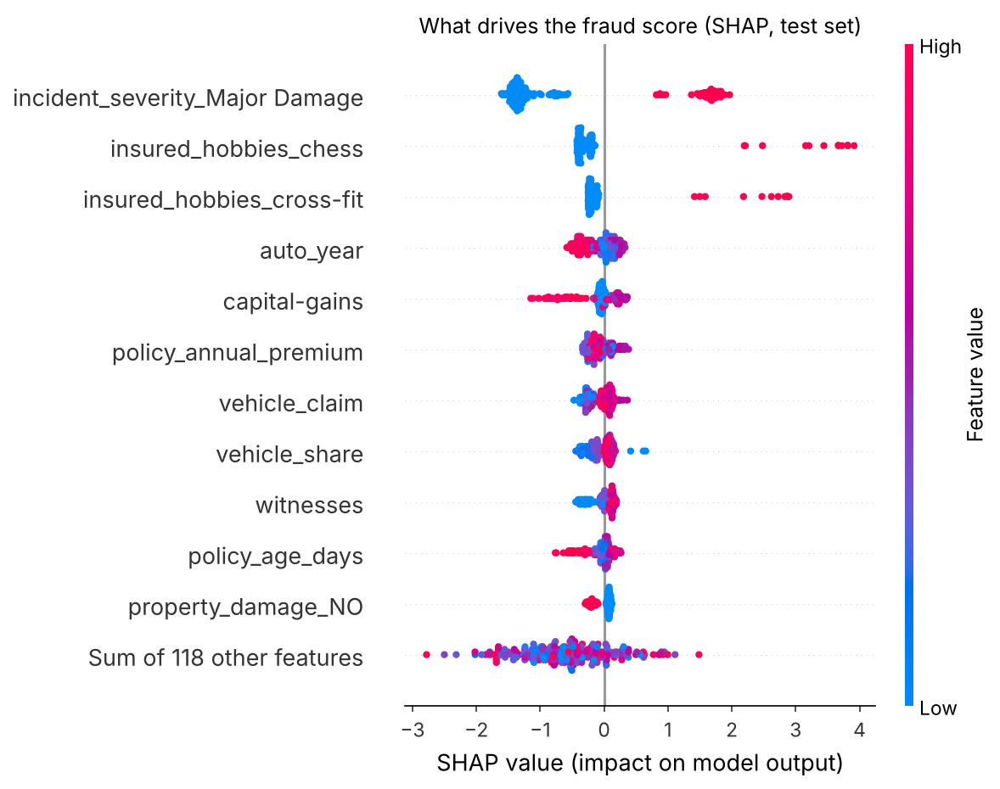
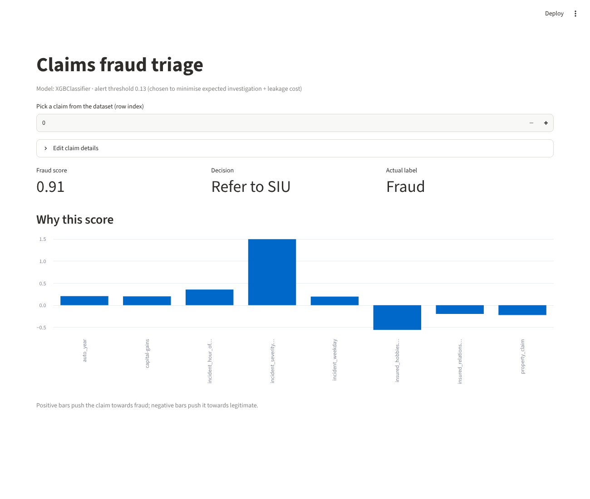

# Insurance Claims Fraud Detection

End-to-end machine learning pipeline that flags potentially fraudulent auto insurance claims for investigation, explains every score with SHAP, and picks its alert threshold from business cost rather than a default 0.5.

   

## Business problem

Claims teams can't investigate every claim. Fast-tracking legitimate claims keeps customers happy, but every fraudulent claim that slips through is paid in full. The goal is to **rank claims by fraud risk and refer only the risky ones to a Special Investigations Unit (SIU)**, while keeping the reasons transparent enough for an investigator to act on.

## Results (held-out test set, 250 claims)

| Metric | Value |
|---|---|
| Model selected (5-fold CV on PR-AUC) | XGBoost |
| ROC-AUC | **0.84** |
| PR-AUC (random baseline = 0.25) | **0.56** |
| Fraud recall at chosen threshold | **89%** (55 of 62 frauds caught) |
| Precision of alerts | 47% |
| Claims referred to SIU | 116 of 250 |
| Estimated cost vs. no model* | **-84%** |

\*Cost assumptions: a missed fraud leaks CAD 10,000; investigating a legitimate claim costs CAD 500. The threshold (0.13) was chosen on cross-validated training predictions to minimise this cost, then applied once to the test set. Change `COST_FALSE_NEGATIVE` / `COST_FALSE_POSITIVE` in `src/fraud/train.py` to reflect a real book of business.

### Model comparison (5-fold stratified CV)

| Model | PR-AUC | ROC-AUC |
|---|---|---|
| Logistic regression (balanced) | 0.612 | 0.853 |
| Random forest (balanced) | 0.540 | 0.830 |
| **XGBoost (scale_pos_weight)** | **0.617** | **0.864** |

<p float="left">
  
  
</p>

### What drives the score



- **Major damage incidents** are by far the strongest signal: severe claims carry the largest payouts and the strongest incentive to inflate.
- **Policyholder hobbies (chess, cross-fit)** rank second and third. I treat this as a **data-quality red flag, not insight**: there's no plausible causal story, and it suggests the public dataset's labels were partly generated from these fields. In production I would remove them and investigate before relying on the model. See the [model card](MODEL_CARD.md).
- Newer vehicles, policy age, witnesses and the vehicle share of the claim add smaller, more intuitive effects.

### Leakage check (`python src/fraud/leakage_check.py`)

| XGBoost, 5-fold CV on all 1,000 claims | PR-AUC | ROC-AUC |
|---|---|---|
| All features | 0.588 | 0.853 |
| Without `insured_hobbies` | 0.488 | 0.762 |

Removing one implausible feature costs about 10 points of ROC-AUC. Much of the headline score rests on a likely artefact, so the **honest production estimate is the lower row**. Catching this before deployment is the point of the exercise.

## Triage app

`streamlit run app.py` scores any claim, applies the cost-based threshold and shows the top reasons behind the score.



## REST API (FastAPI + Docker)

The same model is served as a REST API so other systems (a claims intake service, a batch job) can score claims.

| Endpoint | Purpose |
|---|---|
| `GET /health` | liveness check |
| `GET /schema` | raw fields a claim must include |
| `POST /predict` | fraud score, cost-based decision (`refer_to_siu` / `fast_track`) and top-5 SHAP reasons |

Engineered features (policy age, claim shares, claim-to-premium) are computed server-side from the raw claim, so callers send the same fields as the source data. Missing fields return a 422 listing what is missing.

```bash
docker build -t fraud-api .          # trains the model inside the image
docker run -p 8000:8000 fraud-api    # interactive docs at http://localhost:8000/docs
```

Example response:

```json
{"fraud_score": 0.91, "threshold": 0.13, "decision": "refer_to_siu",
 "top_reasons": [{"feature": "incident_severity_Major Damage", "contribution": 1.49},
                 {"feature": "insured_hobbies_sleeping", "contribution": -0.56}, "..."],
 "model_version": "XGBClassifier"}
```

## Approach

1. **Cleaning:** `?` placeholders become explicit `UNKNOWN` categories (a missing police report is itself informative). Identifiers such as policy number, ZIP code and street address are dropped to avoid memorising rows.
2. **Feature engineering:** policy age at incident, vehicle age, injury/property/vehicle share of the claim, claim-to-premium ratio, and incident weekday.
3. **Class imbalance:** about 25% of claims are fraud. Handled with class weights rather than resampling, and models are compared on PR-AUC because precision on alerts is what investigators feel.
4. **Validation:** stratified 75/25 split. All model selection and threshold tuning happen inside 5-fold CV on the training set, and the test set is used exactly once.
5. **Decision threshold:** chosen by minimising expected cost, not by accuracy.
6. **Explainability:** SHAP global importance for model governance, and per-claim SHAP reasons in the app for investigators.

## Project structure

```
├── app.py                  # Streamlit triage app
├── data/                  # dataset is downloaded automatically on first run
├── Dockerfile              # containerised API
├── src/fraud/
│   ├── data.py             # loading, cleaning, feature engineering
│   ├── api.py              # FastAPI service: /health, /schema, /predict
│   ├── train.py            # CV comparison, threshold, test evaluation, SHAP
│   └── leakage_check.py    # ablation of the suspicious hobby feature
├── reports/
│   ├── metrics.json        # all CV and test metrics
│   ├── top_features.json
│   └── figures/
├── tests/                  # data-contract and API tests (pytest)
├── MODEL_CARD.md
└── requirements.txt
```

## Run it

```bash
pip install -r requirements.txt
python src/fraud/train.py      # trains, evaluates, writes models/ and reports/
pytest -q                      # data + API tests
streamlit run app.py           # triage UI
uvicorn fraud.api:app --app-dir src --port 8000   # REST API
```

## Data

1,000 auto insurance claims with 39 attributes and a `fraud_reported` label, from the public [insurance claims dataset](https://github.com/mwitiderrick/insurancedata), also published on [Mendeley Data](https://data.mendeley.com/datasets/992mh7dk9y). The dataset is small and partly synthetic, so the results demonstrate the method rather than production performance.

## Next steps

- Probability calibration (isotonic) so scores can be read as fraud likelihoods.
- Monitoring: data drift on claim amounts and severity mix, plus monthly precision@k from SIU outcomes.

## Author

**Anisha Persis Christopher**, Data Scientist · [LinkedIn](https://www.linkedin.com/in/anishapersis) · [GitHub](https://github.com/Anishapersis)
